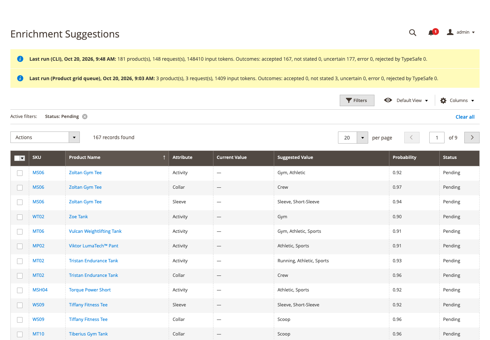
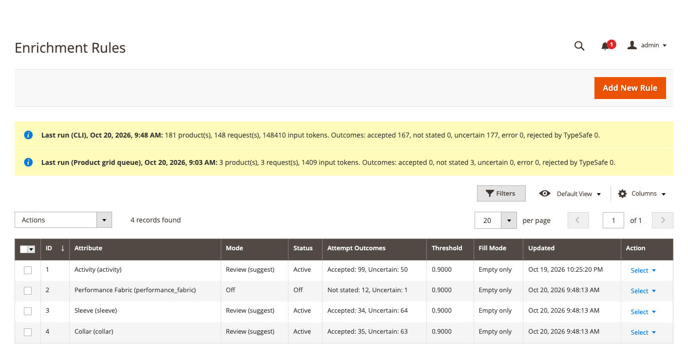
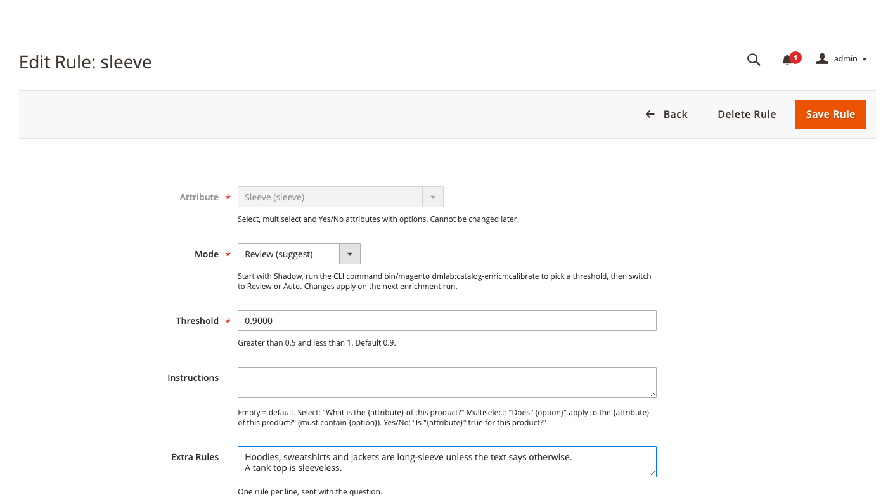

# DmLab_CatalogEnrich

> AI product attribute enrichment for Magento 2: fill empty filter attributes (material, sleeve, seats, Yes/No…) from the product descriptions you already have.

[](https://github.com/dmlab-work/module-catalog-enrich/actions/workflows/ci.yml) [](https://codecov.io/gh/dmlab-work/module-catalog-enrich) [](https://packagist.org/packages/dmlab/module-catalog-enrich) [](https://packagist.org/packages/dmlab/module-catalog-enrich) [](https://packagist.org/packages/dmlab/module-catalog-enrich) [](LICENSE) 

Products with an empty *Material*, *Sleeve* or *Number of seats* never show up for shoppers who filter by them.
Catalog Enrich fills those attributes from the names and descriptions you already have, picking only from the
attribute's existing options. You choose per attribute: record only, wait for review, or apply automatically —
and every applied value can be reverted.



## Install
```bash
composer require dmlab/module-catalog-enrich
bin/magento module:enable DmLab_TypeSafeCore DmLab_CatalogEnrich
bin/magento setup:upgrade
```

## Requirements
Magento 2.4.7+ · PHP 8.2–8.5
- Answers currently come only from [TypeSafe](https://typesafe.ai) (model Jev), through
  [`dmlab/module-typesafe-core`](https://github.com/dmlab-work/module-typesafe-core) (pulled in automatically).
- A TypeSafe API key from [console.typesafe.ai](https://console.typesafe.ai); usage is billed by TypeSafe. The key
  is stored encrypted in your Magento; spend is capped by the *Monthly Token Budget* next to it. A run that hits it
  stops; product-grid runs are re-queued hourly, the nightly run resumes the next night.
- Queue consumers run by `cron_consumers_runner` (or started manually with `bin/magento queue:consumers:start`).

## Quick start
1. **Stores → Configuration → DMLab → TypeSafe** — enable, paste the API key, click *Test Connection*.
2. **Catalog → Catalog Enrichment → Rules → Add New Rule** — pick an attribute. New rules start in *Shadow*
   (answers are recorded, nothing is suggested).
3. Run it: `bin/magento dmlab:catalog-enrich:run --limit=100`, or select products in the product grid →
   *Actions → Enrich attributes*, or enable the nightly cron.
4. `bin/magento dmlab:catalog-enrich:calibrate --attribute=<code>` measures precision on products that already
   have a value and suggests a threshold.
5. Switch the rule to *Review* and approve in **Catalog Enrichment → Suggestions** — or to *Auto*.

| Rules: status and outcomes per attribute | Rule: threshold and extra rules |
|---|---|
|  |  |

**Extra Rules** are the main accuracy lever: one plain sentence per line that tells the model how your catalog
names things ("A tank top is sleeveless.").

## Reference
| | |
|---|---|
| Attributes | select (≤ 254 options), multiselect, Yes/No |
| Writes | default (store 0) values only: empty values, or missing options appended to a multiselect; skips products with a store-view value, configurable variant attributes and values a human rejected |
| Rules | mode `off` · `shadow` · `review` · `auto`; threshold 0.5–1 (default 0.9); fill `empty_only` or `add_missing` (multiselect); *Treat No as Empty* (Yes/No) |
| Admin | Catalog → Catalog Enrichment: Rules, Suggestions (approve / reject / revert), Attempts (*Ask again on next run*) |
| CLI | `dmlab:catalog-enrich:run [--attribute] [--sku] [--limit] [--force] [--dry-run]` · `calibrate --attribute [--sample]` · `report` |
| Settings | Stores → Configuration → DMLab → Catalog Enrichment: extra text attributes, products not visible individually, nightly cron and products per run |
| Background | queue consumers `dmlab.catalog_enrich.products` and `dmlab.catalog_enrich.suggestions`; nightly cron (off by default); hourly re-queue of stopped product-grid runs |
| ACL | `DmLab_CatalogEnrich::rules`, `::suggestions`, `::suggestions_apply`, `::attempts`, `::run`, `::config` |

A product × attribute is sent again only when its text, the options, the rule text or the model change — or when
you ask (`--force`, *Ask again*). Data TypeSafe refuses is not retried until it changes; other errors back off from
1 hour up to 7 days.

Pairs with [`dmlab/module-typesense-search`](https://github.com/dmlab-work/module-typesense-search): filled
attributes become layered-navigation filters on a Typesense engine.

## Data and privacy
Sent to TypeSafe (US-hosted API): product name, short description and description (HTML stripped, up to 6,000
characters), the extra text attributes you chose, the attribute's label and option labels, and your rule text.
No customer or order data. Zero data retention is available on TypeSafe's enterprise plan.

## Architecture
- **Questions** — select and Yes/No are one TypeSafe Choice asked twice, in source and reversed option order, with
  a "not stated" option last in both; a value is accepted only when both answers pick the same option with the
  lower probability ≥ the threshold. A multiselect is one Noul per option. Yes/No is never a Noul, so silence is
  "not stated", not "No".
- **Dedup** — identical requests are answered from `dmlab/module-typesafe-core`'s response cache. The attempt
  ledger stores one row per product × attribute with a fingerprint of everything sent. Threshold, mode and fill
  mode are not part of it: stored answers are re-decided locally.
- **Queues** — topics `dmlab.catalog_enrich.products` (product ids from the grid action) and
  `dmlab.catalog_enrich.suggestions` (approve / revert batches) on the MySQL `db` connection. Grid batches share
  the run lock with CLI and cron; a stopped run (budget, key, circuit) is deferred to the hourly re-queue cron.

## License
[OSL-3.0](LICENSE)
